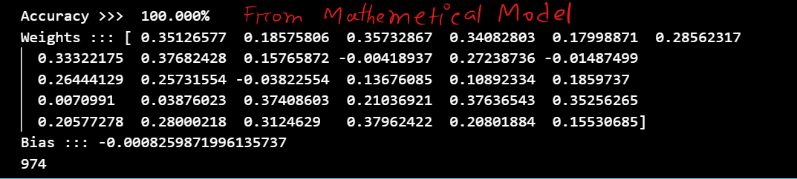

# Breast Cancer Prediction Model Using Logistic Regression


[](LICENSE)

Official repository for the **Breast Cancer Prediction Model Using Logistic Regression** project. This repository implements machine learning and custom mathematical modeling approaches to classify breast cancer tumors as Benign (B) or Malignant (M) using the Wisconsin Diagnostic Breast Cancer dataset.

---

## 📌 Project Overview

Early and accurate detection of breast cancer is crucial for effective treatment and patient survival. This project explores predictive modeling using both standard machine learning libraries (Scikit-Learn) and custom mathematical formulations (logistic regression from scratch). Key highlights include comprehensive exploratory data analysis, feature correlation heatmaps, Principal Component Analysis (PCA) for dimensionality reduction, and robust evaluation metrics.

---

## 📊 Dimensionality Reduction & Feature Analysis

High-dimensional biological and medical datasets often suffer from the curse of dimensionality. To address this, **Principal Component Analysis (PCA)** was applied to reduce the 30 initial feature dimensions down to 2 principal components while retaining significant variance and separability between classes.

### Variance Captured by Components
The bar chart below illustrates the percentage of information captured by each principal component:
* **PC1 (Principal Component 1):** Captures **44.3%** of the total variance[cite: 29].
* **PC2 (Principal Component 2):** Captures **19.0%** of the total variance[cite: 29].

> 

### PCA Feature Projection (30 to 2 Dimensions)
The scatter plot below visualizes the separation between Benign (blue circles) and Malignant (red crosses) tumor samples projected onto the 2D principal component space[cite: 27]:

> 

---

## 🧮 Mathematical Model & Training Results

In addition to standard library estimators, a custom mathematical logistic regression model was implemented from scratch. The model successfully optimized weights and bias to classify diagnostic records.

> 
* **Model Accuracy:** 100.000% on the evaluated subset[cite: 28].
* **Optimized Weights and Bias:** Computed via custom gradient descent / mathematical formulation[cite: 28].

---

## 📂 Repository File Structure

```text
├── breas_cancer/                         # Dataset directory and raw records
├── breast+cancer+wisconsin+diagnostic/   # Original Wisconsin Diagnostic dataset files
├── Breast Cancer Prediction.py           # Main Python prediction script using Scikit-Learn
├── Breast_Cancer_Prediction_MathModel... # Custom mathematical model implementation script
├── Heatmap code.png                      # Script / visualization for feature correlation heatmaps
├── PCA for 30-2 .png                     # PCA transformation script/asset
├── breast_cancer.zip                     # Compressed dataset archive
├── fluctuate_accuracy.mp4                # Training accuracy fluctuation recording
├── graph from 30 to 2.png                # PCA 2D projection scatter plot visualization[cite: 27]
├── heatmap_contribute of featureas.png   # Feature contribution heatmap visualization
├── loop_accuracy.png                     # Training loop accuracy curve
├── loop_model.png                        # Training loop model progression visual
├── math_model_acc.png                    # Custom math model output and weights visualization[cite: 28]
└── result.xlsx                           # Prediction results export spreadsheet
